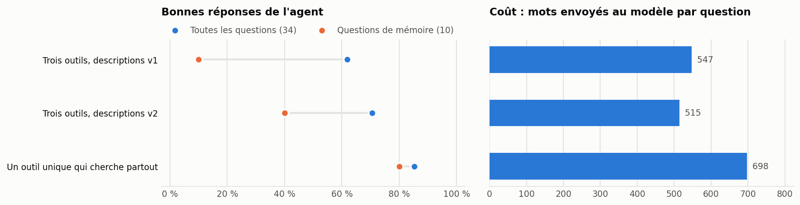
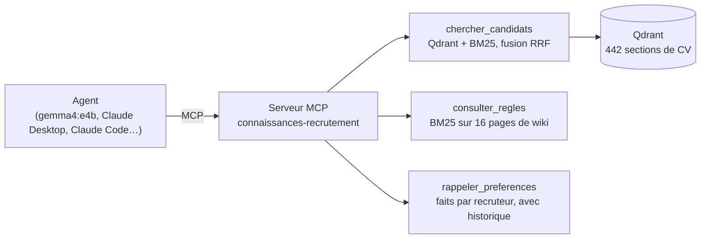

# mcp-connaissances-recrutement

[](https://github.com/frejoyal/mcp-connaissances-recrutement/actions/workflows/verification.yml)

> **Entreprise, candidats, clients et recruteurs fictifs.** Recrutement Élite inc. et tout ce qui la concerne sont inventés ; seules les villes sont réelles.
>
> **Fictional company, candidates, clients and recruiters.** See the [English section](#english).

Un serveur MCP qui réunit trois systèmes de connaissances derrière une seule interface, avec deux mesures. Qdrant donne-t-il les mêmes résultats que la recherche exacte ? Un agent local choisit-il le bon outil ?

Ce dépôt assemble trois bancs d'essai publiés séparément sur le même cabinet fictif :

- [rag-recrutement-bench](https://github.com/frejoyal/rag-recrutement-bench) : la recherche dans 50 CV ;
- [llm-wiki-recrutement](https://github.com/frejoyal/llm-wiki-recrutement) : le wiki des règles internes ;
- [memoire-agent-recrutement](https://github.com/frejoyal/memoire-agent-recrutement) : la mémoire des préférences de chaque recruteur.



## Le mandat

Recrutement Élite inc. a maintenant trois systèmes : une recherche de CV, un wiki de règles et une mémoire des préférences. Le cabinet ne veut pas que son assistant, ou un autre outil comme Claude Desktop, ait à connaître trois systèmes. Il veut un seul point d'entrée standard, et une base de vecteurs qui tienne en production quand la banque de CV grandira.

## L'architecture



- **[connaissances/serveur.py](connaissances/serveur.py)** : le serveur MCP (SDK Python officiel `mcp` 2.3, transport stdio), avec trois outils. Une variante n'expose qu'un outil, `chercher_partout`, qui interroge les trois sources à la fois.
- **[connaissances/sources.py](connaissances/sources.py)** : la recherche dans chaque source.
  - **CV :** recherche hybride, avec les 100 sections les plus proches selon Qdrant et BM25 sur toutes les sections, fusionnées par rangs réciproques. C'est la meilleure méthode sans reclassement du banc RAG.
  - **Règles :** BM25 sur les pages du wiki, la méthode la plus sobre du dépôt LLM Wiki.
  - **Préférences :** les faits retenus pour chaque recruteur, avec leur historique.
- **Qdrant :** en mode local par défaut, avec des fichiers sur le disque et sans serveur. Avec `QDRANT_URL`, le serveur MCP se connecte à un serveur Qdrant ; [docker-compose.yml](docker-compose.yml) en lance un, persistant. Les vecteurs viennent de `bge-m3` ; une nouvelle requête est vectorisée par Ollama.

## Mesure 1 : Qdrant contre la recherche exacte

[connaissances/verifier_qdrant.py](connaissances/verifier_qdrant.py) indexe les 442 sections de CV et pose les 60 questions du banc RAG.

| Contrôle | Résultat |
|---|--:|
| Qdrant trouve les 10 mêmes sections que la recherche exacte | 60 sur 60 |
| … dans le même ordre | 59 sur 60 (une égalité de scores) |
| L'outil donne le même premier candidat que l'hybride calculé sur toutes les sections | 60 sur 60 |
| … et les cinq mêmes candidats | 56 sur 60 (l'outil ne prend que 100 sections de Qdrant) |
| Bon candidat en premier | 31 sur 45 (69 %, comme le banc RAG) |
| Bon candidat dans les trois premiers | 35 sur 45 (78 %, comme le banc RAG) |

La CI fait ce contrôle deux fois : avec Qdrant en mode local, et avec un vrai serveur Qdrant 1.20.0 lancé par Docker. Les deux doivent donner exactement le rapport publié.

## Mesure 2 : l'agent choisit-il le bon outil ?

[connaissances/evaluer_agent.py](connaissances/evaluer_agent.py) est un vrai client MCP. Il lance le serveur, lit la liste de ses outils et donne ces outils à `gemma4:e4b`, qui tourne en local. Chaque appel d'outil passe par le protocole.

Les 34 questions sont dans [evaluation/questions-agent.json](evaluation/questions-agent.json) :
- 10 sur les CV, 10 sur les règles et 10 sur les préférences, reprises des trois bancs d'essai avec leurs réponses attendues ;
- 4 qui demandent deux sources, par exemple Julie qui demande « quelle garantie s'applique à Assurances Riveraine, et combien de candidats dois-je mettre dans ma short-list ? ».

| Interface | Bonnes réponses | CV | Règles | Préférences | Deux sources | Bon premier outil | Appels d'outils par question | Mots envoyés par question |
|---|--:|--:|--:|--:|--:|--:|--:|--:|
| Trois outils, descriptions v1 | 62 % | 9 sur 10 | 9 sur 10 | **1 sur 10** | 2 sur 4 | 73 % | 1,03 | 547 |
| Trois outils, descriptions v2 | 71 % | 8 sur 10 | 9 sur 10 | 4 sur 10 | 3 sur 4 | 83 % | 1,06 | 515 |
| Un outil unique qui cherche partout | **85 %** | 8 sur 10 | 9 sur 10 | **8 sur 10** | **4 sur 4** | sans objet | 1,00 | 698 |

« Bon premier outil » porte sur les 30 questions qui ne demandent qu'une source. Les réponses, et les outils appelés pour chaque question, sont dans [resultats/resultats-agent.json](resultats/resultats-agent.json).

### Ce qu'on en retient

1. **Avec un petit modèle local, le choix de l'outil est le maillon faible.** Avec les descriptions v1, l'agent envoie presque toutes les questions sur les préférences d'un recruteur vers le wiki des règles. À « combien de candidats dois-je mettre dans mes short-lists ? », il cherche une règle, n'en trouve pas, et répond qu'il ne sait pas. Il réussit 1 question de préférence sur 10, alors que la mémoire contient la réponse.
2. **Les descriptions des outils comptent.** La v2, écrite après avoir lu ces erreurs, décrit la mémoire comme « ce que le recruteur t'a dit » et précise que le wiki ne contient pas les préférences personnelles. Le bon premier outil passe de 73 % à 83 %, et les préférences de 1 à 4 sur 10. Mais une question qui nomme un client (« pourquoi Riveraine a refusé le candidat c042 ? ») part encore vers les règles.
3. **L'agent n'essaie presque jamais un deuxième outil.** Il fait en moyenne un seul appel par question. Quand le premier outil ne trouve rien, il répond qu'il ne sait pas au lieu de chercher ailleurs.
4. **Avec ce modèle, un outil unique qui cherche partout fait mieux** : 85 % de bonnes réponses, et les quatre questions à deux sources réussies, pour environ 30 % de texte de plus envoyé au modèle. Le serveur fait le routage à la place du modèle. L'idée de « trois outils simples » suppose un modèle qui choisit bien ; avec un modèle de 8 milliards de paramètres, c'est à mesurer avant de le supposer.
5. **Changer de base de vecteurs ne change pas les réponses.** Qdrant, en mode local ou en serveur, trouve les mêmes sections que la recherche exacte, et l'outil garde les scores du banc RAG. En mode local, Qdrant compare toutes les sections ; un serveur Qdrant ne construit son index approximatif (HNSW) qu'au-delà d'un seuil de taille. Quand la banque de CV grandira, ce contrôle sera à refaire.

### Limites

- L'échantillon est petit : 34 questions, une exécution, un seul modèle d'agent. Une question vaut 3 points.
- Les questions viennent des trois bancs d'essai, écrites avant ces mesures. Les descriptions v2 ont été écrites après avoir lu les erreurs de la v1 : leur gain est mesuré sur les mêmes questions, ce qui l'avantage. La v1 et la v2 sont publiées toutes les deux.
- Si l'agent veut répondre sans avoir appelé d'outil, on lui demande une fois de chercher. C'est arrivé de 2 à 4 fois par interface.
- Les agents plus gros, comme Claude dans Claude Desktop ou Claude Code, ne sont pas mesurés ici. Ils se connectent au même serveur.

## Utiliser le serveur

```bash
python -m venv .venv
.venv/Scripts/pip install -r requirements.txt      # sous Linux ou macOS : .venv/bin/pip
python serveur_mcp.py                               # serveur MCP en stdio (il faut Ollama avec bge-m3 pour les nouvelles requêtes)
```

- **Claude Desktop :** copiez [mcp/claude_desktop_config.exemple.json](mcp/claude_desktop_config.exemple.json) dans la configuration de Claude Desktop, et remplacez les chemins.
- **Claude Code :** `claude mcp add connaissances-recrutement -- <chemin>/.venv/Scripts/python <chemin>/serveur_mcp.py`.
- **Serveur Qdrant :** `docker compose up -d`, puis `QDRANT_URL=http://localhost:6333`.
- **Interface :** `CONNAISSANCES_OUTILS=unique` expose l'outil unique ; `trois` donne les descriptions v1 ; par défaut, ce sont les trois outils avec les descriptions v2.

## Reproduire

Le dépôt contient les vecteurs de toutes les requêtes mesurées et les réponses de l'agent ([resultats/cache/](resultats/cache/)). Tout se rejoue sans modèle :

```bash
pip install -r requirements.txt
export CONNAISSANCES_MODE=cache QDRANT_CHEMIN=:memory:
python -m connaissances.verifier_qdrant --verifier   # Qdrant contre la recherche exacte
python -m connaissances.evaluer_agent --verifier     # l'agent et le serveur MCP, sur les 34 questions et les trois interfaces
```

Pour tout recalculer, il faut [Ollama](https://ollama.com) avec `gemma4:e4b` et `bge-m3`, puis `python -m connaissances.evaluer_agent --mode direct` et `python resultats/graphique.py` (avec matplotlib).

## Structure

```text
connaissances/   le serveur MCP, les trois sources, la vérification de Qdrant et l'évaluation de l'agent
donnees/         les 50 CV, les 16 pages du wiki et les faits retenus par la mémoire, repris des trois bancs d'essai
evaluation/      les 60 questions de CV et les 34 questions de l'agent
resultats/       les rapports, le graphique et le cache
mcp/             un exemple de configuration pour Claude Desktop
```

Le code a été écrit avec l'aide de Claude. L'agent mesuré est `gemma4:e4b`, en local.

## English

**Fictional company, candidates, clients and recruiters.** Only the cities are real.

An MCP server that puts three knowledge systems behind one interface, and two measurements. It brings together three benchmarks published separately on the same fictional firm: résumé search ([rag-recrutement-bench](https://github.com/frejoyal/rag-recrutement-bench)), an internal-rules wiki ([llm-wiki-recrutement](https://github.com/frejoyal/llm-wiki-recrutement)) and per-recruiter memory ([memoire-agent-recrutement](https://github.com/frejoyal/memoire-agent-recrutement)).

- **Server:** official Python MCP SDK 2.3, stdio transport, three tools (`chercher_candidats`, `consulter_regles`, `rappeler_preferences`), or a single `chercher_partout` tool. Résumé vectors live in Qdrant (local mode by default, or a Qdrant server via Docker Compose); search is hybrid (Qdrant + BM25, RRF).
- **Qdrant check:** on the 60 résumé questions, Qdrant returns the same top 10 sections as exact search (60/60), and the tool keeps the benchmark's scores (69% top-1, 78% top-3). CI runs the check against both local mode and a real Qdrant 1.20.0 server.
- **Agent check:** a real MCP client gives the tools to `gemma4:e4b` and asks 34 questions (résumés, rules, recruiter preferences, and 4 that need two sources). With three tools, the small model routes preference questions to the rules wiki: 62% correct overall, 1/10 on preferences. Rewritten tool descriptions bring it to 71% (4/10). A single search-everything tool reaches 85%, with all four two-source questions right, at 30% more context. The agent almost never tries a second tool after an empty result.
- **Reproducibility:** query vectors and agent responses are cached; CI replays everything through the MCP protocol without a model and fails on any difference.

The code was written with help from Claude.

## Licence

[MIT](LICENSE). License: [MIT](LICENSE).
